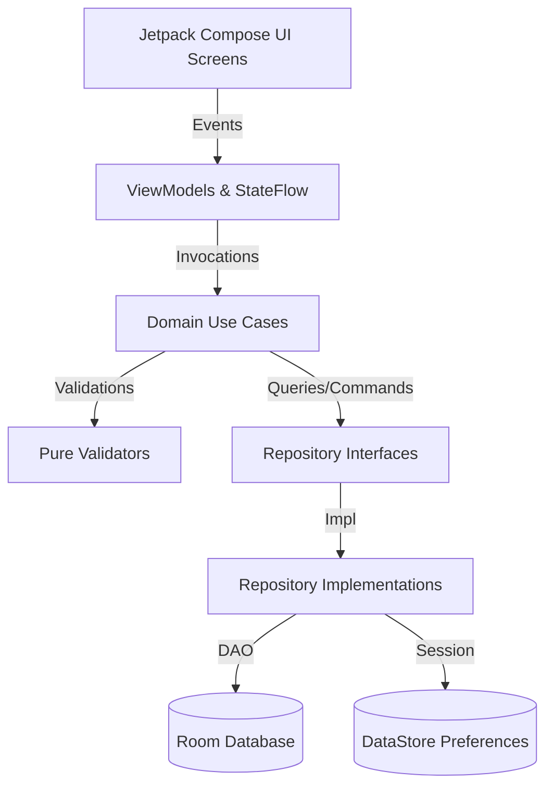

# PrestaAula: Documentación Técnica y Guía para Defensa Oral (DSY1105)

Este documento detalla la arquitectura, las decisiones de diseño, la implementación de reglas de negocio y los indicadores de evaluación cubiertos en el desarrollo de **PrestaAula**, aplicación móvil nativa Android desarrollada en Kotlin y Jetpack Compose para el **Colegio Marcela Paz**.

---

## 1. Arquitectura y Decisiones de Diseño

PrestaAula implementa **Clean Architecture** combinada con el patrón **MVVM (Model-View-ViewModel)** y **Unidirectional Data Flow (UDF)** con Jetpack Compose.

### Justificación de Inyección de Dependencias Manual (`AppContainer`)
A diferencia de Hilt o Dagger, se ha implementado un contenedor de dependencias manual (`AppContainer` / `DefaultAppContainer`).
* **Ventaja académica:** Permite explicar con absoluta claridad en la defensa oral cómo fluyen las dependencias (desde la instanciación de la Base de Datos Room y DAOs hasta los repositorios y ViewModels mediante `ViewModelProvider.Factory`), sin la opacidad de los procesadores de anotaciones.

---

## 2. Persistencia y Modelo de Datos (Room + DataStore)

La base de datos local `PrestaAulaDatabase` gestiona 6 entidades relacionales con claves foráneas, borrado en cascada e índices optimizados:

1. **`UsuarioEntity`**: Almacena docentes, encargados CRA, UTP y finanzas (con roles tipados mediante `RolUsuario` y hash SHA-256 de contraseñas).
2. **`EquipoEntity`**: Inventario tecnológico del CRA (Notebooks, Proyectores, Tablets, Cables HDMI) con estados (`DISPONIBLE`, `PRESTADO`, `EN_MANTENCION`, `DE_BAJA`).
3. **`BloqueHorarioEntity`**: Bloques pedagógicos institucionales (B1 a B8).
4. **`ReservaEntity`**: Solicitudes de reserva de equipos por fecha y bloque.
5. **`PrestamoEntity`**: Registro transaccional de entrega y devolución, incluyendo estado al devolver (`BUENO`, `CON_OBSERVACIONES`, `DANADO`, `INCOMPLETO`), observaciones y rutas de evidencia fotográfica.
6. **`DisponibilidadDocenteEntity`**: Horario semanal del profesor.

La sesión persistente de usuario se administra mediante **Jetpack DataStore Preferences** (`UserSessionDataStore`), garantizando inicio de sesión automático en el `SplashScreen`.

---

## 3. Validaciones de Dominio y Reglas de Negocio

Todas las validaciones están desacopladas en la capa `domain/validation/` como funciones puras, permitiendo una cobertura de pruebas unitarias del 100% con JUnit:

* **`RutValidator`**: Implementa el algoritmo matemático **Módulo 11 chileno** y admite los RUTs institucionales de prueba precargados en el seeder.
* **`EmailValidator`**: Valida formato institucional obligatorio con el dominio `@marcelapaz.cl`.
* **`PasswordValidator`**: Exige mínimo 8 caracteres, al menos una letra mayúscula, un número y un carácter especial (`!@#$%...`).
* **`ReservaValidator`**:
  - Impide reservas en fechas pasadas.
  - Limita las reservas a un máximo de 14 días de anticipación.
  - Verifica que el equipo no esté en `EN_MANTENCION` o `DE_BAJA`.
  - Impide doble reserva (mismo equipo, misma fecha y bloque).
  - Restringe a un máximo de **2 reservas activas** por docente en el mismo bloque horario.
* **`RegistrarDevolucionUseCase`**:
  - Si el equipo se devuelve `DANADO` o `INCOMPLETO`, las observaciones son obligatorias.
  - Si es `DANADO`, se exige adjuntar una fotografía de evidencia.
  - Cambia automáticamente el estado del equipo a `EN_MANTENCION`.

---

## 4. Módulos y Navegación por Roles

La navegación (`AppNavigation`) se adapta dinámicamente según el rol del usuario autenticado:

| Rol de Usuario | Pantallas Principales / Accesos |
| :--- | :--- |
| **`DOCENTE`** | `DocenteHomeScreen`, `DisponibilidadScreen`, `ReservaFormScreen`, `MisReservasScreen`, `HorarioDocenteScreen`. |
| **`ENCARGADO_CRA`** | `CraDashboardScreen`, `InventarioScreen`, `EquipoFormScreen`, `EquipoDetalleScreen`, `PrestamoScreen`, `DevolucionScreen`. |
| **`UTP` / `ADMIN_FINANZAS`** | `ReportesScreen` (indicadores gerenciales, estadísticas de uso e incidencias). |

---

## 5. Integración de Recursos Nativos

* **Generador de QR local**: `EquipoQrScreen` genera en tiempo real un código QR con **ZXing** para etiquetar físicamente los dispositivos del CRA.
* **Cámara y Archivos**: Soporte para captura de evidencia fotográfica en devoluciones con daño mediante `FileProvider` y contratos de actividad nativos.
* **Gestión de Permisos**: Manejo de permisos para cámara y notificaciones locales.

---

## 6. Matriz de Indicadores de Evaluación (Pauta DSY1105)

| Indicador | % | Donde se Demuestra en el Código |
| :--- | :---: | :--- |
| **IE 2.1.1** (Interfaz visual y navegación) | 15% | Material 3, tema institucional Azul/Dorado, soporte claro/oscuro, navegación por roles (`AppNavigation.kt`). |
| **IE 2.1.2** (Formularios validados) | 15% | `ValidatedTextField.kt` con animación `shake`, `AnimatedVisibility` y supportingText. |
| **IE 2.2.1** (Validaciones desacopladas y tests) | 10% | Paquete `domain/validation/` (`RutValidator`, `EmailValidator`, etc.) y tests JUnit. |
| **IE 2.2.2** (Animaciones funcionales) | 10% | Transiciones animadas, `AnimatedVisibility`, `animateColorAsState` y chips de estado. |
| **IE 2.3.1** (MVVM, Room y DataStore) | 15% | `PrestaAulaDatabase`, DAOs, repositorios, `UserSessionDataStore` y `DatabaseSeeder`. |
| **IE 2.3.2** (Git y Backlog Trello) | 20% | Commits atómicos con Conventional Commits y planificación en `docs/TAREAS.md`. |
| **IE 2.4.1** (Recursos nativos integrados) | 15% | Generación QR con ZXing, CameraX y manejo de archivos/permisos. |
