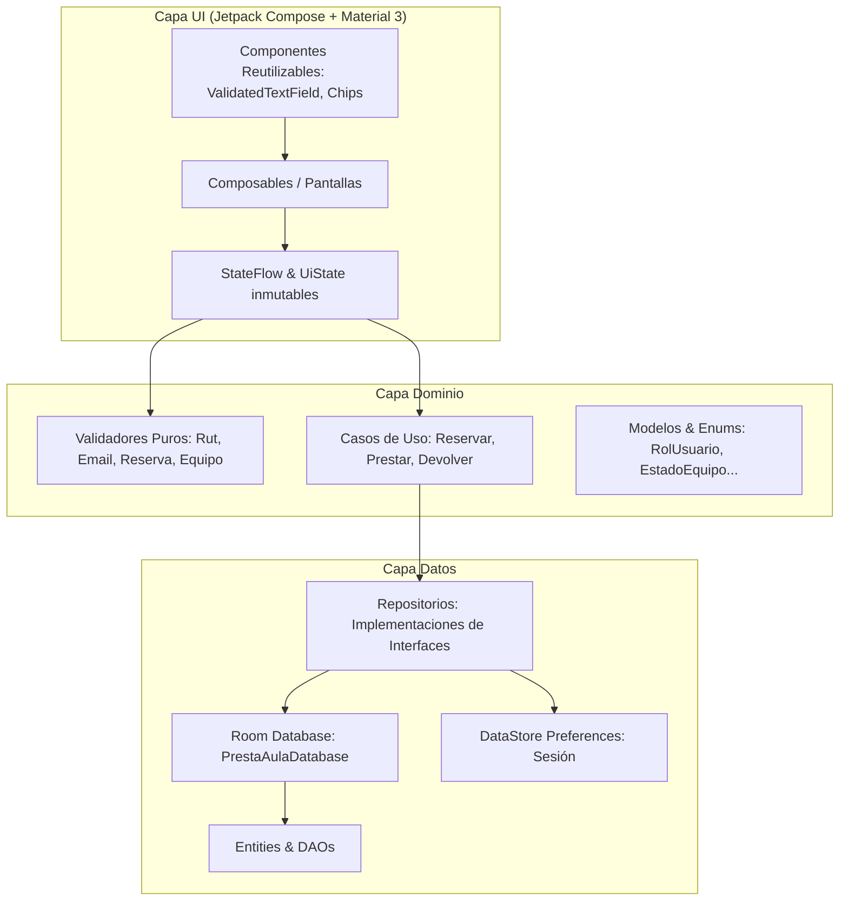

# PrestaAula — Sistema Móvil de Gestión de Préstamos CRA
**Colegio Marcela Paz** • Asignatura: DSY1105 Desarrollo de Aplicaciones Móviles (Duoc UC)  
**Evaluación Parcial 2**

---

## 👥 Datos del Proyecto
* **Integrantes**:
  * [Nombre Apellido 1]
  * [Nombre Apellido 2]
* **Número de Equipo**: [N]
* **Enlace Tablero Trello**: [https://trello.com/b/PrestaAula-DSY1105](https://trello.com/b/PrestaAula-DSY1105)

---

## 📖 Contexto del Caso
El **Colegio Marcela Paz** (establecimiento particular subvencionado con enseñanza pre-básica, básica y media) dispone de un Centro de Recursos para el Aprendizaje (CRA) y sala de tecnología con notebooks, tablets, proyectores, cables HDMI y otros recursos audiovisuales que los profesores retiran para sus clases.

### Problemática Actual
Actualmente, los préstamos se registran a mano en un cuaderno de papel. Esto provoca:
1. **Colisiones de horario**: Dos profesores asumen que disponen del mismo proyector para el mismo bloque lectivo y uno se queda sin equipo.
2. **Falta de trazabilidad ante daños**: Cuando un recurso vuelve dañado (pantalla rota, cargador faltante), resulta casi imposible reconstruir quién fue el último docente responsable.

### Solución PrestaAula
Una aplicación móvil nativa Android en Kotlin y Jetpack Compose donde:
* Los docentes consultan disponibilidad y reservan equipos con anticipación desde su celular.
* El encargado del CRA registra entregas y recepciones en máximo 2 pasos mediante lectura de códigos QR.
* Se registra evidencia fotográfica obligatoria ante devoluciones con observaciones o daños, enviando el equipo a mantención de manera automática.

---

## 🏛️ Arquitectura de Software (MVVM + Repositorios)

La aplicación sigue la arquitectura oficial recomendada por Android (Clean Architecture en capas MVVM) con separación estricta entre la interfaz de usuario, la lógica de dominio y la persistencia local.



---

## ⚖️ Reglas de Negocio Implementadas

1. **Evitar doble reserva**: No pueden existir dos reservas activas para el mismo equipo en la misma fecha y bloque horario.
2. **Equipos inhabilitados**: Ningún equipo con estado `EN_MANTENCION` o `DE_BAJA` puede ser reservado ni prestado.
3. **Plazos de anticipación**: No se permite reservar en fechas u horarios pasados. Plazo máximo de reserva anticipada: **14 días**.
4. **Límite de reservas por docente**: Un docente no puede mantener más de **2 reservas activas** para el mismo bloque horario.
5. **Transición al retiro**: Al entregar el equipo, la reserva cambia a `RETIRADA`, el equipo a `PRESTADO` y se genera el registro del préstamo en una sola transacción atómica de Room.
6. **Manejo de devoluciones con daño**: Al recepcionar un equipo con estado `DANADO` o `INCOMPLETO`, este pasa automáticamente a `EN_MANTENCION`, la observación y la fotografía son estrictamente obligatorias, y queda guardado el docente responsable.
7. **Trazabilidad en un toque**: Cualquier equipo del inventario permite consultar de inmediato su último docente responsable y su historial completo de préstamos.
8. **Vencimiento automático**: Las reservas activas cuyo bloque horario terminó sin haber sido retiradas pasan al estado `VENCIDA`.

---

## 📱 Recursos Nativos y Gestión de Permisos

1. **Cámara (`android.permission.CAMERA`)**:
   * Usado para tomar fotografías de evidencia del estado de los equipos al ser devueltos con observaciones o daños, y para fotografía opcional al registrar un equipo en el inventario.
   * Manejado mediante `ActivityResultContracts.TakePicture` y `FileProvider` con almacenamiento seguro en directorio interno de la app.
   * Rationale explicativo antes de solicitar el permiso y alternativa manual en caso de rechazo.
2. **Escáner y Generación de Códigos QR**:
   * Escáner en tiempo real mediante `CameraX` + `Google ML Kit Barcode Scanning` para abrir de inmediato el flujo de entrega o recepción del equipo.
   * Pantalla con generador de códigos QR locales (vía ZXing) para facilitar pruebas tanto en emulador como en dispositivos físicos.
3. **Notificaciones Locales (`android.permission.POST_NOTIFICATIONS`)**:
   * Servicio en segundo plano con `WorkManager` y `NotificationManager`.
   * Recordatorio automático al docente 10 minutos antes del inicio de su bloque reservado y notificación de alerta al terminar el bloque si el equipo no ha sido devuelto al CRA.

---

## 👤 Usuarios de Prueba para Defensa

| Rol | Email Institucional | Contraseña | Nombre Completo | RUT |
| :--- | :--- | :--- | :--- | :--- |
| **DOCENTE** | `carlos.gomez@marcelapaz.cl` | `Docente2026!` | Carlos Gómez Silva | 14.567.890-2 |
| **DOCENTE** | `maria.rodriguez@marcelapaz.cl` | `Docente2026!` | María Rodríguez Pinto | 16.234.567-8 |
| **ENCARGADO_CRA** | `marcela.valenzuela@marcelapaz.cl` | `Cra2026!Paz` | Marcela Valenzuela T. | 13.987.654-K |
| **UTP** | `patricia.lagos@marcelapaz.cl` | `Utp2026!Paz` | Patricia Lagos Fuente | 11.456.789-5 |
| **ADMIN_FINANZAS** | `roberto.munoz@marcelapaz.cl` | `Finanzas2026!` | Roberto Muñoz Castro | 12.345.678-5 |

---

## 🛠️ Decisiones de Diseño

1. **Inyección de Dependencias Manual (`AppContainer`)**: Se optó por un contenedor manual centralizado en lugar de Hilt / Dagger. Esta decisión simplifica la comprensión de la arquitectura y la defensa en vivo ante la comisión evaluadora, manteniendo el desacoplamiento sin complejidades de metaprogramación o dependencias externas pesadas.
2. **Almacenamiento Local 100% Autónomo**: De acuerdo con los requisitos académicos, la app no depende de Firebase ni APIs externas; la persistencia se realiza íntegramente mediante SQLite (Room) con cifrado/hashing local de contraseñas.
3. **Flujo de Préstamo Rápido en 2 Pasos**: Pensado para el intervalo de 5 minutos entre cambios de hora, el encargado solo necesita escanear el QR del equipo y confirmar al docente para formalizar la entrega.
4. **Validación de Formularios Desacoplada**: Todos los validadores (`RutValidator`, `EmailValidator`, `ReservaValidator`) residen en `domain/validation` y son funciones puras independientes de cualquier API de Android, lo que garantiza su testeabilidad unitaria con JUnit estándar.
5. **Generador Offline de QR**: Se incluyó generación local de QR en pantalla para que el docente o evaluador pueda probar el escáner apuntando desde otro dispositivo o con la cámara del emulador.

---

## 🚀 Pasos para Ejecutar el Proyecto

### Requisitos Previos
* Android Studio (Koala, Ladybug o superior).
* Java Development Kit (JDK) 17.
* Android SDK Platform 34 (Android 14) o superior.

### Instrucciones
1. Clonar el repositorio:
   ```bash
   git clone https://github.com/tu-usuario/PrestaAula.git
   cd PrestaAula
   ```
2. Abrir la carpeta raíz del proyecto en Android Studio.
3. Esperar que Gradle sincronice las dependencias del catálogo (`gradle/libs.versions.toml`).
4. Seleccionar un emulador con API 26 o superior (recomendado API 34).
5. Presionar **Run 'app'** (`Shift + F10`).

### Ejecución de Pruebas Unitarias
Para ejecutar todos los tests unitarios automatizados:
```bash
./gradlew test
```

---

## 📋 Checklist de Funcionalidades e Indicadores de Evaluación

- [x] **IE 2.1.1 — Interfaz visual organizada y navegación clara (15%)**: Material 3, colores institucionales, adaptabilidad, tema claro/oscuro, navegación por roles.
- [x] **IE 2.1.2 — Formularios validados por campo (15%)**: `ValidatedTextField` con iconos leading/trailing, supportingText animado, shake al error y snackbars.
- [x] **IE 2.2.1 — Validaciones desacopladas y tests (10%)**: Validadores puros en `domain/validation`, `ValidationResult`, tests unitarios con JUnit.
- [x] **IE 2.2.2 — Animaciones funcionales (10%)**: Transiciones animadas entre pantallas, `AnimatedVisibility`, `animateColorAsState` en chips de estado, shake en formulario.
- [x] **IE 2.3.1 — MVVM, Room y DataStore (15%)**: Repositorios, base de datos Room, sesión persistente en DataStore, datos semilla iniciales.
- [x] **IE 2.3.2 — Git y Planificación Trello (20%)**: Commits atómicos convencionales en español, backlog detallado en `docs/TAREAS.md`.
- [x] **IE 2.4.1 — Recursos nativos integrados (15%)**: Cámara con FileProvider, escáner y generador QR con ML Kit, notificaciones con WorkManager y manejo de permisos.

---

## 🔮 Pendientes para la Evaluación Final Transversal (EFT)
* Sincronización en la nube mediante API REST opcional para respaldo corporativo.
* Exportación de reportes a formato PDF directamente al almacenamiento del dispositivo.
* Módulo de firma digital del docente al retirar equipos de alto valor.
